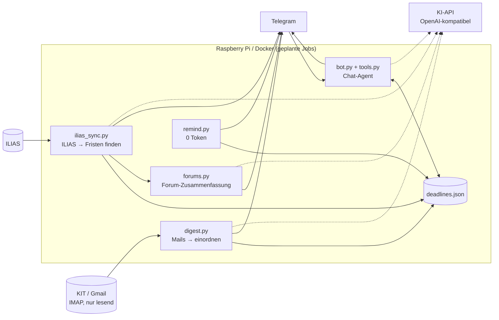

# KIT Study Assistant (KIT-Lernassistent)

[](https://github.com/lattiezhao-a11y/kit-study-assistant/actions/workflows/docker.yml)

[English](README.md) · [中文](README.zh-CN.md) · **Deutsch**

Ein schlanker, selbst gehosteter KI-Assistent für Studierende am KIT. Er läuft auf einem Raspberry Pi oder einem beliebigen kleinen Server (Docker) und spricht über Telegram mit dir.
Er liest deine Uni-Mails und ILIAS, findet jede Abgabefrist und erinnert dich, bevor es zu spät ist.
Du kannst ihm auch ganz normal Fragen stellen. Der Bot spricht Deutsch oder Chinesisch, je nachdem, was du wählst.

- **Keine Abhängigkeiten:** nur die Python-Standardbibliothek, insgesamt etwa 3.000 Zeilen
- **Günstig:** Hat sich nichts geändert, kostet ein Lauf 0 Token. Eine Chatnachricht kostet etwa 500–3.000 Token
- **Grundsätzlich nur lesend:** Er sendet, löscht oder verschiebt keine Mails und markiert sie auch nicht als gelesen

> Ich habe das für mein eigenes Semester gebaut. Seit November 2026 läuft es jeden Tag auf einem Raspberry Pi 4.

## Das Problem

Jeder Kurs in ILIAS veröffentlicht Fristen anders:

| Kurs | Wo die Frist steht |
|---|---|
| Kurs A | Im ILIAS-Kalender (iCal) |
| Kurs B | In einem Ordnernamen: `Übungsblatt 03 (16.11.2026 - 23.11.2026)` |
| Kurs C | In einer Tabelle auf der Kursseite: „Übung 1–7, jeweils 12 Uhr“ |
| Kurs D | Nur im PDF des Übungsblatts |

Dazu kommen Fristverlängerungen per Mail, und die wichtigen Mails gehen zwischen Newslettern unter.
Andere Tools decken nur einen Teil davon ab. ILIAS-Downloader wie [PFERD](https://github.com/Garmelon/PFERD) holen Dateien, lesen aber keine Fristen.
Frist-Bots gibt es meist für Canvas oder Moodle, die eine richtige API haben.

## Was er macht

| | Funktion | Wann |
|---|---|---|
| 📬 | **Mail-Zusammenfassung:** sortiert neue Mails von KIT und Gmail in *Zu erledigen* / *Lesenswert* / *Ignoriert*. Jede Mail bekommt ihren Originalbetreff und eine Zusammenfassung in einem Satz in deiner Sprache. Ignorierte Mails werden trotzdem aufgelistet, damit du Fehler bemerkst | 01:30, 07:30, 13:30, 19:30 |
| 📚 | **ILIAS-Fristen:** liest den iCal-Feed, Kursseiten, Ordnernamen und neue Übungsblatt-PDFs. Eine KI zieht die Fristen heraus | dieselben Läufe |
| 🔁 | **Verschiebungen:** Steht in einer Mail, dass eine Frist verschoben wurde, wird das alte Datum durchgestrichen und das neue eingetragen | dieselben Läufe |
| 💬 | **Forum-Zusammenfassung:** ein Satz pro ILIAS-Forenthread mit neuen Beiträgen | täglich, 19:30 |
| ☀️ | **Morgenübersicht:** Fristen und To-dos der nächsten 3 Tage | 07:00 |
| ⏰ | **Dringende Erinnerung:** alles, was in weniger als 3 Stunden fällig ist | stündlich, 07–23 Uhr |
| 🤖 | **Chat-Bot:** „Was ist diese Woche noch offen?“, „BS-Blatt 3 ist abgegeben“, „Was stand in der Mail vom Tutor?“, „Was steht morgen an?“ | immer |

Der Bot hat 19 Werkzeuge:

| Bereich | Werkzeuge |
|---|---|
| Fristen | anzeigen, hinzufügen, ändern, löschen, als erledigt markieren |
| To-dos | anzeigen, hinzufügen, löschen, als erledigt markieren |
| Mails | auflisten, lesen (nur lesend, letzte 7 Tage) |
| Einstellungen | anzeigen, ändern (Änderungen musst du bestätigen) |
| Stundenplan | anzeigen, hinzufügen, entfernen, dazu ein kombinierter Tagesplan |
| Forum | neueste Threads, einen Thread lesen |

## Aufbau



- **Die geplanten Jobs sind einfache Skripte, keine Agenten.** Jeder Lauf macht höchstens einen gebündelten KI-Aufruf.
- **Der Chat-Bot ist eine minimale Tool-Calling-Schleife** (`bot.py`, etwa 400 Zeilen). Er nutzt Telegram-Long-Polling, es wird also kein Port geöffnet. Er antwortet nur deiner eigenen Chat-ID und vergisst das Gespräch nach 1 Stunde Pause.
- **Eine gemeinsame Datendatei.** Mails, ILIAS und der Bot schreiben alle in `deadlines.json`, geschützt durch eine Dateisperre.

## Designentscheidungen

**Token nur für neue Informationen ausgeben.**
Jede ILIAS-Seite wird mit der Version vom letzten Mal verglichen, nur geänderter Text geht an die KI.
Von den neuen Dateien wird nur bei denen, deren Name nach Übung aussieht (`Übung`, `Blatt`, `Exercise`, `Abgabe` …), die erste PDF-Seite gelesen.
Mails werden von HTML, Zitaten, Signaturen und Links befreit und dann auf etwa 300 Zeichen gekürzt.
Echte Zahlen:

| Aufgabe | Token |
|---|---|
| 8 Mails einordnen | ca. 1.300 |
| Erster kompletter ILIAS-Durchlauf (13 Fristen gefunden) | ca. 15.000 |
| ILIAS-Lauf ohne Änderungen | 0 |
| Eine Chatnachricht | 500–3.000 |

Zum Vergleich: Derselbe Chat über ein allgemeines Agenten-Framework (OpenClaw) brauchte etwa 10.000–20.000 Token pro Nachricht. Deshalb habe ich einen eigenen kleinen Bot geschrieben.

**Keine wichtige Mail darf verloren gehen.**
Ist sich die KI unsicher, wählt sie *Lesenswert* statt *Ignoriert*.
Jede ignorierte Mail wird trotzdem mit Absender und Betreff aufgelistet.
Ein Sicherheitsnetz (eine Absenderliste) kann Mails nur *hoch*stufen, nie herunter.
Fällt ein Postfach oder die KI aus, kommt die Zusammenfassung trotzdem und sagt, was nicht geklappt hat. Nicht eingeordnete Mails bekommen einen eigenen Abschnitt.

**Sicherheit.**
- Postfächer werden nur lesend geöffnet und mit `BODY.PEEK` abgerufen, Mails werden also nie als gelesen markiert. Es gibt überhaupt keinen SMTP-Code.
- Die KI kann eine Einstellungsänderung nur *vorschlagen*. Das Programm führt sie erst aus, wenn du mit «ja» (bzw. «确认») bestätigst, und sichert die Konfiguration vorher.
- Forenbeiträge gehen ohne Namen an die KI, nur als „Lehrende/Tutor“ oder „Studierende“.
- Die Prompts weisen das Modell an, Anweisungen in Mails zu ignorieren. Eine ungültige Kategorie vom Modell zählt als *nicht eingeordnet*.
- Alle Geheimnisse liegen in `.env` (`chmod 600`). Im Code und in der Konfiguration steht nichts Geheimes.

## Einrichtung

Du brauchst nur einen Rechner, der immer läuft. Es muss kein Raspberry Pi sein: Ein kostenloser oder günstiger Cloud-Server, ein NAS oder ein alter Laptop geht auch.
Außerdem brauchst du einen Telegram-Bot-Token von [@BotFather](https://t.me/BotFather) und einen API-Key für eine beliebige OpenAI-kompatible KI (ich nutze DeepSeek).

### Variante 1: Docker (empfohlen, läuft überall)

```bash
git clone https://github.com/lattiezhao-a11y/kit-study-assistant.git
cd kit-study-assistant
mkdir data
docker compose run --rm assistant python3 setup.py              # Einrichtungsassistent, ca. 5 Minuten
docker compose run --rm assistant python3 digest.py --dry-run   # Test, sendet nichts
docker compose up -d                                            # starten
```

📖 **Schritt-für-Schritt-Anleitung, vom leeren Cloud-Server bis zur ersten Telegram-Nachricht: [docs/deploy-cloud.de.md](docs/deploy-cloud.de.md)**

Im Container ersetzt ein kleiner Zeitplaner (`scheduler.py`) systemd. Er hält denselben Zeitplan ein, hält den Bot am Laufen und holt eine verpasste Mail-Prüfung nach einem Neustart nach.
Deine Einstellungen und Daten liegen in `data/`, getrennt vom Code.

### Variante 2: direkt auf einem Raspberry Pi / Linux mit systemd

So betreibe ich es selbst. Du brauchst Python 3.11+ und `poppler-utils` (zum Lesen von PDFs).

```bash
sudo apt install poppler-utils
git clone https://github.com/lattiezhao-a11y/kit-study-assistant.git
cd kit-study-assistant/mail_digest

python3 setup.py                             # Einrichtungsassistent: schreibt config.toml und .env

python3 digest.py --dry-run --no-llm         # Mails lesen, nur ausgeben, ohne KI, ohne Telegram
python3 digest.py --dry-run                  # mit KI, weiterhin nur ausgeben
python3 ilias_sync.py --dry-run              # ILIAS-Fristen, nur ausgeben
```

Damit es automatisch läuft, die systemd-Units installieren:

```bash
sudo cp deploy/*.service deploy/*.timer /etc/systemd/system/
sudo systemctl daemon-reload
sudo systemctl enable --now mail-digest.timer morning-summary.timer remind.timer bot.service
```

Die Unit-Dateien gehen vom Benutzer `pi` und dem Pfad `/home/pi/mail_digest` aus. Passe sie an, wenn das bei dir anders ist.

**Gmail** braucht die Bestätigung in zwei Schritten und ein [App-Passwort](https://myaccount.google.com/apppasswords).
**Hotmail/Outlook.com** erlaubt keine Passwörter mehr über IMAP. Leite die Mails stattdessen an Gmail weiter.

### Der Einrichtungsassistent

`setup.py` fragt zuerst nach deiner Sprache (Deutsch oder Chinesisch), dann stellt er eine Frage nach der anderen und prüft jede Antwort sofort:

- **KIT-Konto:** meldet sich bei ILIAS und im KIT-Postfach an (nur lesend), Tippfehler fallen also sofort auf
- **Kurse:** **listet alle Kurse auf, in denen du in ILIAS bist**, nach Semester sortiert, die aus diesem Semester schon ausgewählt. Deine Tutorien werden automatisch den richtigen Kursen zugeordnet, du musst also nie Kursnummern aus URLs abschreiben
- **KI-Key:** wird über den `/models`-Endpunkt geprüft, das kostet 0 Token
- **Telegram:** Du schickst deinem Bot eine Nachricht, und der Assistent findet deine Chat-ID selbst

Passwörter werden unsichtbar eingegeben und nur in `.env` geschrieben (`chmod 600`). Gespeichert wird erst nach der letzten Frage, und Strg+C ändert nichts.
Lieber von Hand ausfüllen? Dann `config.example.toml` und `.env.example` kopieren.

**Neues Semester?** `python3 setup.py --courses` wählt die Kurse neu und lässt alle anderen Einstellungen in Ruhe.
Nur deine Kurse ansehen: `python3 ilias_courses.py`.

## Tests

```bash
python3 tests/run_tests.py            # über 100 Prüfungen, ca. 0,05 $ an Token
python3 tests/run_tests.py --no-llm   # nur Werkzeug-Tests, 0 Token
python3 tests/test_setup.py           # Einrichtungsassistent + Kursliste, offline, 0 Token
```

Die Tests arbeiten mit temporären Kopien der Daten. Deine echten Fristen und Einstellungen werden also nie verändert, und an Telegram wird nichts geschickt.
Teil A ruft jedes Werkzeug direkt auf. Teil B schickt etwa 20 Anfragen in normaler Sprache an das Modell und prüft, ob es das richtige Werkzeug wählt, vor Änderungen nachfragt und nie interne IDs anzeigt.

## Einschränkungen

- **Der ILIAS-Login funktioniert nur am KIT** (Shibboleth über `idp.scc.kit.edu`, ohne 2FA), an anderen Unis geht der ILIAS-Teil also noch nicht. Der Mail-Teil funktioniert mit jedem IMAP-Postfach.
- **Bot, Nachrichten und Einrichtungsassistent gibt es auf Deutsch und Chinesisch** (Auswahl im Assistenten, Wechsel jederzeit mit /language in Telegram). Eine englische Oberfläche gibt es noch nicht; alle Texte stehen in `i18n.py`, eine neue Sprache ist also vor allem Übersetzungsarbeit.
- **Die meisten Tests brauchen eine echte `config.toml`** und Zugriff aufs Postfach. GitHub Actions baut nur das Docker-Image und führt die Tests aus, die kein Konto brauchen (Formatierung, Datenordner, Zeitplaner, Einrichtungsassistent).
- **Wer einen Forenthread öffnet, markiert ihn in ILIAS als gelesen.** So funktioniert ILIAS. Sonst wird dort nichts verändert.
- Ohne Docker läuft es nur unter Linux/macOS (nutzt `fcntl`). Unter Windows bitte Docker verwenden.

## Fahrplan

- [x] Docker-Image + Anleitung für Cloud-Server, damit kein Raspberry Pi nötig ist
- [ ] ILIAS-Instanz und Login konfigurierbar machen, damit andere Unis es nutzen können
- [x] Interaktiver Einrichtungsassistent (`setup.py`), der deine ILIAS-Kurse auflistet und deine Telegram-Chat-ID findet
- [x] Deutsche Version (Bot, Nachrichten, Einrichtungsassistent)
- [x] GitHub Actions: Docker-Image bauen + Tests, die kein Konto brauchen
- [ ] Offline-Testdaten (gefälschtes Postfach / ILIAS-Seiten), damit jedes Werkzeug auf GitHub getestet werden kann
- [ ] Testset für die Fristerkennung (Precision / Recall)
- [ ] Optional lokale KI (Ollama), damit keine Daten das Gerät verlassen

## Lizenz

[MIT](LICENSE)
