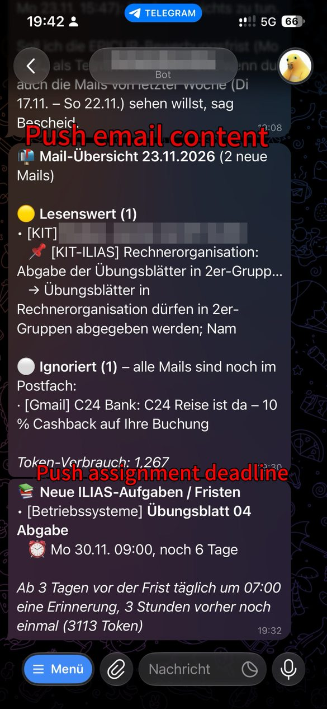
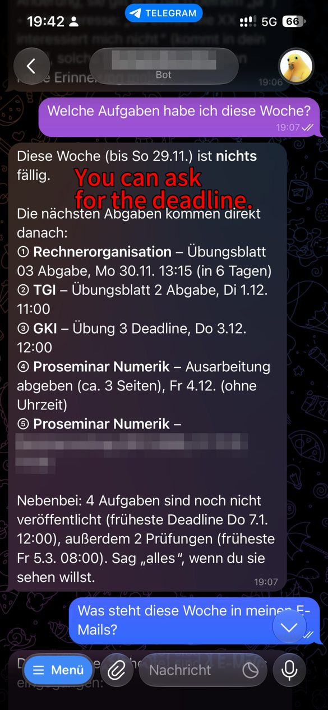
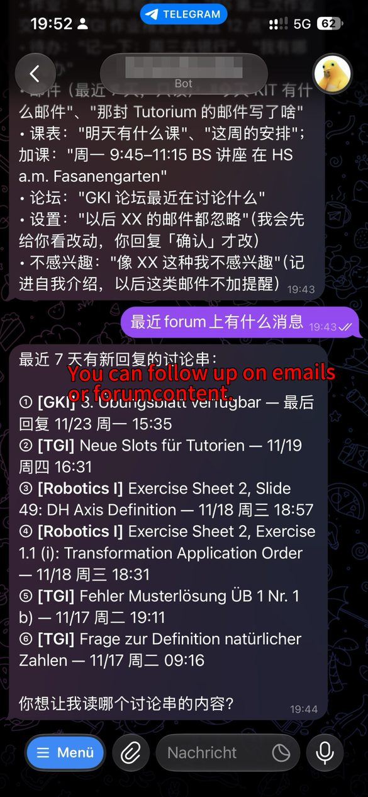
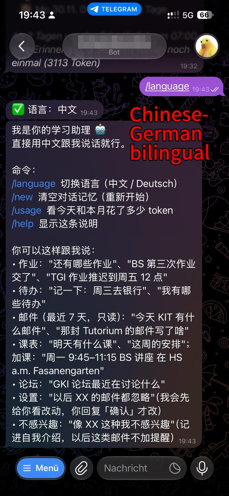
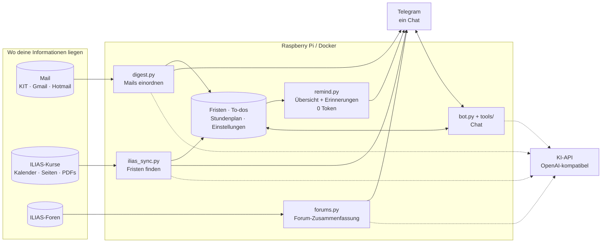

# KIT Study Assistant (KIT-Lernassistent)

[](https://github.com/lattiezhao-a11y/kit-study-assistant/actions/workflows/docker.yml)

[English](README.md) · [中文](README.zh-CN.md) · **Deutsch**

**Ein Telegram-Chat für alles, was du im Studium am KIT im Blick behalten musst.**

Ein selbst gehosteter Telegram-Bot mit KI: Er liest deine Postfächer, deine ILIAS-Kurse und ihre Foren und hält Fristen, To-dos und Stundenplan an einem Ort zusammen.
Er meldet sich nur, wenn etwas dich betrifft, und zur richtigen Zeit. Du kannst ihn auch ganz normal fragen.
Er läuft auf einem Raspberry Pi oder einem beliebigen kleinen Server (Docker) und spricht Deutsch oder Chinesisch.

- **Ultraleicht:** Gibt es nichts Neues, kostet ein Lauf 0 Token; gibt es etwas Neues, werden Token nur für das Neue ausgegeben. Nur die Python-Standardbibliothek, keine Abhängigkeiten
- **Grundsätzlich nur lesend:** Er sendet, löscht oder verschiebt keine Mails und markiert sie auch nicht als gelesen

> Ich habe das für mein eigenes Semester gebaut. Seit November 2026 läuft es jeden Tag auf einem Raspberry Pi 4.

<p>
  
  
  
  
</p>

## Warum ich das gebaut habe

Im Studium am KIT ist alles, was du im Blick behalten musst, über viele Orte verteilt:

- **Mehrere Postfächer.** Uni-Mail, Gmail, Hotmail. Die Rückmeldung oder eine Mail vom Professor steckt zwischen Newslettern, Login-Warnungen und Bestätigungscodes.
- **ILIAS, jeder Kurs anders.** Jeder Kurs legt seine Fristen woanders ab: im Kalender, in einem Ordnernamen wie `Übungsblatt 03 (16.11.2026 - 23.11.2026)`, in einer Tabelle auf der Kursseite oder nur im Übungsblatt-PDF.
- **Änderungen werden festgehalten, wann immer sie passieren.** Eine Frist wird per Mail verschoben, im Forum gibt es eine neue Antwort: Er hält es fest und sagt dir Bescheid.
- **Neue Termine jederzeit hinzufügen.** Stundenplan, das Referat nächsten Monat, „Aufenthaltstitel verlängern“: einmal dem Bot sagen, und es ist notiert.

**Ein Bot statt all dieser Tools.**
(Vorhandene Tools lösen jeweils nur ein Stück. ILIAS-Downloader wie [PFERD](https://github.com/Garmelon/PFERD) holen nur Dateien; Frist-Bots gibt es meist nur für Canvas und Moodle; Mail-Apps wissen nichts über deine Kurse.)

Mit nur diesem Bot siehst du alle wichtigen Termine deines Studiums.

## Ein Tag mit dem Bot

| Wann | Was in Telegram ankommt |
|---|---|
| 07:00 | ☀️ **Morgenübersicht:** Fristen und To-dos für heute, morgen und die nächsten 3 Tage |
| 01:30 · 07:30 · 13:30 · 19:30 | 📬 **Mail-Zusammenfassung:** neue Mails, sortiert in *Zu erledigen* / *Lesenswert* / *Ignoriert*, jeweils mit Betreff und einem Satz Zusammenfassung. Neue ILIAS-Fristen bekommen eine eigene kurze Nachricht |
| 19:30 | 💬 **Forum-Zusammenfassung:** ein Satz pro ILIAS-Thread mit neuen Beiträgen |
| stündlich, 07–23 Uhr | ⏰ **Dringende Erinnerung** für alles, was in weniger als 3 Stunden fällig ist |
| neues Semester | 🎓 **Kurs-Check:** ein neues Semester hat begonnen oder du bist in ILIAS Kursen beigetreten, die noch nicht verfolgt werden; ein Tipp auf den Button, und du wählst sie aus |
| jederzeit | 🤖 **Chat:** Fragen stellen, To-dos eintragen, Abgaben als erledigt markieren, Einstellungen ändern |

Gibt es nichts Neues, bleibt er still.

## Was er zusammenführt

| Quelle | Was er liest | Was du bekommst |
|---|---|---|
| 📬 **Mail**: KIT, Gmail (Hotmail per Weiterleitung) | neue Mails seit dem letzten Lauf, über IMAP nur lesend | eine sortierte Zusammenfassung; Fristen aus Mails landen in deinen Erinnerungen; verschiebt eine Mail eine Frist, wird das alte Datum durchgestrichen und das neue eingetragen; optional ein Abschnitt *Jobangebote*, solange du suchst |
| 📚 **ILIAS-Kurse** | Kalender-Feed, Kursseiten, Ordnernamen, neue Übungsblatt-PDFs | eine Fristenliste über alle deine Kurse |
| 💬 **ILIAS-Foren** | Threads mit neuen Beiträgen | täglich ein Satz pro Thread |
| 🗓️ **Dein Stundenplan und deine To-dos** | was du dem Bot sagst | „Was steht morgen an?“ mit Vorlesungen, Fristen und To-dos; To-dos mit Datum kommen in die Morgenübersicht und die Erinnerungen |
| 🙋 **Du selbst** | was du löschst, was dich nicht interessiert | er lernt dazu: Nach deiner Bestätigung kommt „Kein Interesse: Kurzzeit-Austauschprogramme“ in dein Profil, und solche Mails werden ab dann ignoriert |

Fristen aus Mails werden in **Pflichten** (Übungsblätter, Prüfungsanmeldung, Rückmeldung, Visum: Verpassen hat Folgen) und **Chancen** (Stipendien, Veranstaltungsanmeldungen, Wettbewerbe) aufgeteilt.
Pflichten bekommen Erinnerungen. Chancen werden nur in der Zusammenfassung erwähnt, damit sich deine Erinnerungsliste nicht mit Dingen füllt, die du nie vorhattest.

## Mit ihm reden

„Was ist diese Woche noch offen?“ · „BS-Blatt 3 ist abgegeben“ · „Was stand in der Mail vom Tutor?“ · „Was steht morgen an?“ · „Erinner mich am 1. an die Miete“ · „Zeig mir keine LinkedIn-Mails mehr“

Der Bot hat 21 Werkzeuge:

| Bereich | Werkzeuge |
|---|---|
| Fristen | anzeigen, hinzufügen, ändern, löschen, als erledigt markieren |
| To-dos | anzeigen, hinzufügen, löschen, als erledigt markieren |
| Mails | auflisten, lesen (nur lesend, letzte 7 Tage) |
| Einstellungen | anzeigen, ändern (Änderungen musst du bestätigen) |
| Stundenplan | anzeigen, hinzufügen, entfernen, dazu ein kombinierter Tagesplan |
| Forum | neueste Threads, einen Thread lesen |
| Kurse | Kursliste öffnen (ankreuzen und speichern machst du selbst per Button) |
| Sprache | Chinesisch / Deutsch, sofort umgeschaltet |

## Aufbau

**In einem Satz: eine zeitgesteuerte KI-Pipeline + ein Tool-Calling-Agent, hinter einem Telegram-Chat.**
Die Pipeline meldet sich nach Zeitplan; der Agent antwortet, wenn du fragst.



- **Pipeline: Jede Quelle hat ihr eigenes kleines Skript**, das nach Zeitplan läuft (auf dem Pi mit systemd, in Docker mit `scheduler.py`). Es sind einfache Skripte, keine Agenten: Jeder Lauf macht höchstens einen gebündelten KI-Aufruf.
- **Alle landen in denselben Datendateien.** Mails, ILIAS und der Bot schreiben in eine Fristenliste (`deadlines.json`, geschützt durch eine Dateisperre). So kommen eine Frist aus einem PDF und ihre Verschiebung per Mail an derselben Stelle an.
- **Agent: Der Chat-Bot ist eine minimale Tool-Calling-Schleife** (`bot.py`, etwa 500 Zeilen). Das Modell entscheidet, welche der 21 Werkzeuge es aufruft und wann es fertig ist, höchstens 6 Runden pro Nachricht; Änderungen an Einstellungen musst du trotzdem bestätigen. Er nutzt Telegram-Long-Polling, es wird also kein Port geöffnet. Er antwortet nur deiner eigenen Chat-ID und vergisst das Gespräch nach 1 Stunde Pause.
- **Eine neue Quelle hinzufügen** heißt: ein weiteres Skript, das in dieselben Dateien schreibt und an denselben Chat sendet.

## Designentscheidungen

**Token nur für neue Informationen ausgeben.**
Jede ILIAS-Seite wird mit der Version vom letzten Mal verglichen, nur geänderter Text geht an die KI.
Von den neuen Dateien wird nur bei denen, deren Name nach Übung aussieht (`Übung`, `Blatt`, `Exercise`, `Abgabe` …), die erste PDF-Seite gelesen.
Mails werden von HTML, Zitaten, Signaturen und Links befreit und dann auf etwa 300 Zeichen gekürzt.
Echte Zahlen:

| Aufgabe | Token |
|---|---|
| 8 Mails einordnen | ca. 1.300 |
| Erster kompletter ILIAS-Durchlauf (13 Fristen gefunden) | ca. 15.000 |
| ILIAS-Lauf ohne Änderungen | 0 |
| Eine Chatnachricht | 500–3.000 |

Zum Vergleich: Derselbe Chat über ein allgemeines Agenten-Framework (OpenClaw) brauchte etwa 10.000–20.000 Token pro Nachricht. Deshalb habe ich einen eigenen kleinen Bot geschrieben.

**Keine wichtige Mail darf verloren gehen.**
Ist sich die KI unsicher, wählt sie *Lesenswert* statt *Ignoriert*.
Jede ignorierte Mail wird trotzdem mit Absender und Betreff aufgelistet.
Ein Sicherheitsnetz (eine Absenderliste) kann Mails nur *hoch*stufen, nie herunter.
Fällt ein Postfach oder die KI aus, kommt die Zusammenfassung trotzdem und sagt, was nicht geklappt hat. Nicht eingeordnete Mails bekommen einen eigenen Abschnitt.

**Sicherheit.**
- Postfächer werden nur lesend geöffnet und mit `BODY.PEEK` abgerufen, Mails werden also nie als gelesen markiert. Es gibt überhaupt keinen SMTP-Code.
- Du entscheidest pro Postfach, ob seine Mails an die KI gehen dürfen.
- Die KI kann eine Einstellungsänderung nur *vorschlagen*. Das Programm führt sie erst aus, wenn du mit «ja» (bzw. «确认») bestätigst, und sichert die Konfiguration vorher.
- Forenbeiträge gehen ohne Namen an die KI, nur als „Lehrende/Tutor“ oder „Studierende“.
- Die Prompts weisen das Modell an, Anweisungen in Mails zu ignorieren. Eine ungültige Kategorie vom Modell zählt als *nicht eingeordnet*.
- Alle Geheimnisse liegen in `.env` (`chmod 600`). Im Code und in der Konfiguration steht nichts Geheimes.

## Einrichtung

Du brauchst nur einen Rechner, der immer läuft. Es muss kein Raspberry Pi sein: Ein kostenloser oder günstiger Cloud-Server, ein NAS oder ein alter Laptop geht auch.
Außerdem brauchst du einen Telegram-Bot-Token von [@BotFather](https://t.me/BotFather) und einen API-Key für eine beliebige OpenAI-kompatible KI (ich nutze DeepSeek).

### Variante 1: Docker (empfohlen, läuft überall)

```bash
git clone https://github.com/lattiezhao-a11y/kit-study-assistant.git
cd kit-study-assistant
mkdir data
docker compose run --rm assistant python3 wizard.py              # Einrichtungsassistent, ca. 5 Minuten
docker compose run --rm assistant python3 digest.py --dry-run   # Test, sendet nichts
docker compose up -d                                            # starten
```

📖 **Schritt-für-Schritt-Anleitung, vom leeren Cloud-Server bis zur ersten Telegram-Nachricht: [docs/deploy-cloud.de.md](docs/deploy-cloud.de.md)** ([English](docs/deploy-cloud.md) · [中文](docs/deploy-cloud.zh-CN.md))

Im Container ersetzt ein kleiner Zeitplaner (`scheduler.py`) systemd. Er hält denselben Zeitplan ein, hält den Bot am Laufen und holt eine verpasste Mail-Prüfung nach einem Neustart nach.
Deine Einstellungen und Daten liegen in `data/`, getrennt vom Code.

### Variante 2: direkt auf einem Raspberry Pi / Linux mit systemd

So betreibe ich es selbst. Du brauchst Python 3.11+ und `poppler-utils` (zum Lesen von PDFs).

```bash
sudo apt install poppler-utils
git clone https://github.com/lattiezhao-a11y/kit-study-assistant.git
cd kit-study-assistant/mail_digest

python3 wizard.py                             # Einrichtungsassistent: schreibt config.toml und .env

python3 digest.py --dry-run --no-llm         # Mails lesen, nur ausgeben, ohne KI, ohne Telegram
python3 digest.py --dry-run                  # mit KI, weiterhin nur ausgeben
python3 ilias_sync.py --dry-run              # ILIAS-Fristen, nur ausgeben
```

Damit es automatisch läuft, die systemd-Units installieren:

```bash
sudo cp deploy/*.service deploy/*.timer /etc/systemd/system/
sudo systemctl daemon-reload
sudo systemctl enable --now mail-digest.timer morning-summary.timer remind.timer bot.service
```

Die Unit-Dateien gehen vom Benutzer `pi` und dem Pfad `/home/pi/mail_digest` aus. Passe sie an, wenn das bei dir anders ist.

**Gmail** braucht die Bestätigung in zwei Schritten und ein [App-Passwort](https://myaccount.google.com/apppasswords).
**Hotmail/Outlook.com** erlaubt keine Passwörter mehr über IMAP. Leite die Mails stattdessen an Gmail weiter.

### Der Einrichtungsassistent

`wizard.py` fragt zuerst nach deiner Sprache (Deutsch oder Chinesisch), dann stellt er eine Frage nach der anderen und prüft jede Antwort sofort:

- **KIT-Konto:** meldet sich bei ILIAS und im KIT-Postfach an (nur lesend), Tippfehler fallen also sofort auf
- **Kurse:** **listet alle Kurse auf, in denen du in ILIAS bist**, nach Semester sortiert, die aus diesem Semester schon ausgewählt. Deine Tutorien werden automatisch den richtigen Kursen zugeordnet, du musst also nie Kursnummern aus URLs abschreiben
- **KI-Key:** wird über den `/models`-Endpunkt geprüft, das kostet 0 Token
- **Telegram:** Du schickst deinem Bot eine Nachricht, und der Assistent findet deine Chat-ID selbst

Passwörter werden unsichtbar eingegeben und nur in `.env` geschrieben (`chmod 600`). Gespeichert wird erst nach der letzten Frage, und Strg+C ändert nichts.
Lieber von Hand ausfüllen? Dann `config.example.toml` und `.env.example` kopieren.

### Neues Semester

1. **Tritt zuerst in ILIAS den Kursen dieses Semesters bei** (und deinem Tutorium). Der Bot sieht nur Kurse, denen du in ILIAS beigetreten bist; er meldet dich nirgends an.
2. Einmal am Tag schaut die erste ILIAS-Prüfung nach 07:00 auf deine Kursliste. Hat ein neues Semester begonnen oder bist du Kursen beigetreten, die noch nicht verfolgt werden, bekommst du eine Telegram-Nachricht mit dem Button **📚 Kurse wählen**. Jeder Kurs wird nur einmal gemeldet.
3. Tipp darauf (oder schick jederzeit `/courses`, oder schreib einfach „Kurse neu wählen“), dann schickt der Bot eine Liste zum Ankreuzen. Darin stehen nur Kurse, denen du in ILIAS beigetreten bist: die dieses Semesters und die, die gerade verfolgt werden. Antippen schaltet ✅ / ⬜ um; erst **Speichern** ändert etwas. Vorher wird `config.toml` gesichert, bisherige Kurse behalten Kurznamen und Einstellungen, neue Kurse werden ab der nächsten ILIAS-Prüfung abgefragt.

Im Terminal geht es auch: `python3 wizard.py --courses` wählt die Kurse neu und lässt alle anderen Einstellungen in Ruhe.
Nur deine Kurse ansehen: `python3 ilias_courses.py`.

## Tests

```bash
python3 tests/run_tests.py            # über 100 Prüfungen, ca. 0,05 $ an Token
python3 tests/run_tests.py --no-llm   # nur Werkzeug-Tests, 0 Token
python3 tests/test_wizard.py           # Einrichtungsassistent + Kursliste, offline, 0 Token
```

Die Tests arbeiten mit temporären Kopien der Daten. Deine echten Fristen und Einstellungen werden also nie verändert, und an Telegram wird nichts geschickt.
Teil A ruft jedes Werkzeug direkt auf. Teil B schickt etwa 20 Anfragen in normaler Sprache an das Modell und prüft, ob es das richtige Werkzeug wählt, vor Änderungen nachfragt und nie interne IDs anzeigt.

## Einschränkungen

- **Der ILIAS-Login funktioniert nur am KIT** (Shibboleth über `idp.scc.kit.edu`, ohne 2FA), an anderen Unis geht der ILIAS-Teil also noch nicht. Der Mail-Teil funktioniert mit jedem IMAP-Postfach.
- **Bot, Nachrichten und Einrichtungsassistent gibt es auf Deutsch und Chinesisch** (Auswahl im Assistenten, Wechsel jederzeit mit /language in Telegram). Eine englische Oberfläche gibt es noch nicht; alle Texte stehen in `i18n.py`, eine neue Sprache ist also vor allem Übersetzungsarbeit.
- **Die meisten Tests brauchen eine echte `config.toml`** und Zugriff aufs Postfach. GitHub Actions baut nur das Docker-Image und führt die Tests aus, die kein Konto brauchen (Formatierung, Datenordner, Zeitplaner, Einrichtungsassistent).
- **Wer einen Forenthread öffnet, markiert ihn in ILIAS als gelesen.** So funktioniert ILIAS. Sonst wird dort nichts verändert.
- Ohne Docker läuft es nur unter Linux/macOS (nutzt `fcntl`). Unter Windows bitte Docker verwenden.

## Fahrplan

- [x] Docker-Image + Anleitung für Cloud-Server, damit kein Raspberry Pi nötig ist
- [ ] ILIAS-Instanz und Login konfigurierbar machen, damit andere Unis es nutzen können
- [x] Interaktiver Einrichtungsassistent (`wizard.py`), der deine ILIAS-Kurse auflistet und deine Telegram-Chat-ID findet
- [x] Deutsche Version (Bot, Nachrichten, Einrichtungsassistent)
- [x] GitHub Actions: Docker-Image bauen + Tests, die kein Konto brauchen
- [ ] Offline-Testdaten (gefälschtes Postfach / ILIAS-Seiten), damit jedes Werkzeug auf GitHub getestet werden kann
- [ ] Testset für die Fristerkennung (Precision / Recall)
- [ ] Optional lokale KI (Ollama), damit keine Daten das Gerät verlassen

## Lizenz

[MIT](LICENSE)
