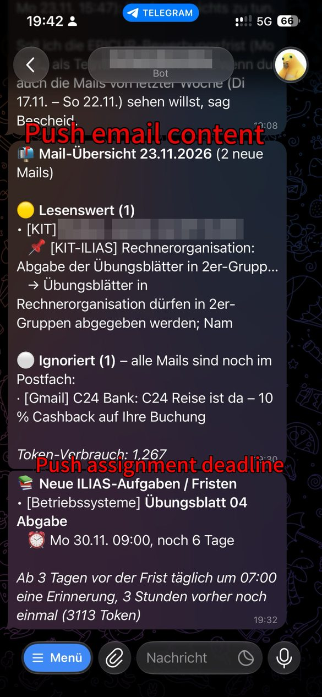
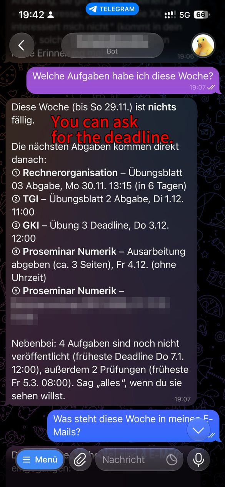
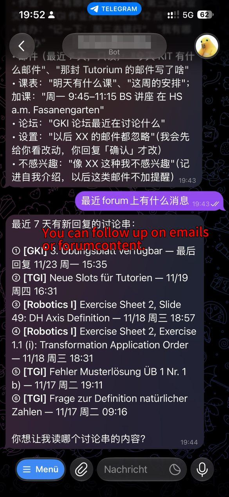
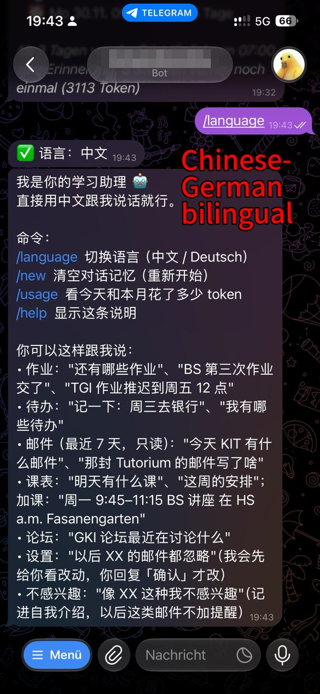
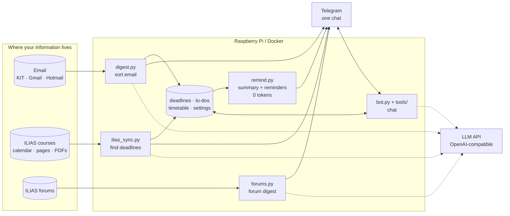

# KIT Study Assistant

[](https://github.com/lattiezhao-a11y/kit-study-assistant/actions/workflows/docker.yml)

**English** · [中文](README.zh-CN.md) · [Deutsch](README.de.md)

**One Telegram chat for everything a KIT student has to keep track of.**

A self-hosted AI assistant that reads your inboxes, your ILIAS courses and their forums, and keeps your deadlines, to-dos and timetable in one place.
It tells you only what needs you, at the right time, and you can ask it anything in plain language.
It runs on a Raspberry Pi or any small server (Docker) and speaks Chinese or German.

- **Ultra-lightweight:** 0 tokens when nothing is new; when something is, tokens are spent only on the new part. Python standard library only, zero dependencies
- **Read-only by design:** it never sends, deletes, moves or marks email as read

> I built this for my own semester. It has been running every day on a Raspberry Pi 4 since November 2026.

<p>
  
  
  
  
</p>

## Why I built this

Studying at KIT, the things you have to keep track of are spread over many places:

- **Several inboxes.** University mail, Gmail, Hotmail. The Rückmeldung fee notice or a mail from your professor sits between newsletters, login alerts and verification codes.
- **ILIAS, one course at a time.** Every course puts its deadlines somewhere else: in the calendar, in a folder name like `Übungsblatt 03 (16.11.2026 - 23.11.2026)`, in a table on the course page, or only inside the exercise PDF.
- **Changes are tracked whenever they happen.** A deadline postponed by email, a new reply in a forum: it records them and tells you.
- **Add new plans any time.** Your timetable, next month's talk, "renew the residence permit": tell the bot once and it's recorded.

**One bot instead of all those tools.**
(Existing tools each solve only one piece. ILIAS downloaders such as [PFERD](https://github.com/Garmelon/PFERD) only fetch files; deadline bots mostly support only Canvas and Moodle; mail apps know nothing about your courses.)

With just this bot, you see every important date of your studies.

## A day with the assistant

| When | What arrives in Telegram |
|---|---|
| 07:00 | ☀️ **Morning summary:** deadlines and to-dos for today, tomorrow and the next 3 days |
| 01:30 · 07:30 · 13:30 · 19:30 | 📬 **Email digest:** new mail sorted into *must act* / *maybe read* / *ignored*, each with its subject and a one-line summary. New ILIAS deadlines get a short message of their own |
| 19:30 | 💬 **Forum digest:** one sentence per ILIAS thread with new posts |
| hourly, 07–23 | ⏰ **Urgent reminder** for anything due within 3 hours |
| new semester | 🎓 **Course check:** a new semester started, or you joined courses on ILIAS that aren't tracked yet; tap the button to pick them |
| any time | 🤖 **Chat:** ask questions, add to-dos, mark homework as done, change settings |

When nothing is new, it stays quiet.

## What it brings together

| Source | What it reads | What you get |
|---|---|---|
| 📬 **Email**: KIT, Gmail (Hotmail via forwarding) | new mail since the last run, over read-only IMAP | a sorted digest; deadlines found in mail go into your reminders; if a mail postpones a deadline, the old date is crossed out and the new one added; an optional *job offers* section while you're job hunting |
| 📚 **ILIAS courses** | calendar feed, course pages, folder names, new exercise PDFs | one deadline list across all your courses |
| 💬 **ILIAS forums** | threads with new posts | a daily one-sentence-per-thread summary |
| 🗓️ **Your timetable and to-dos** | what you tell the bot | "What's on tomorrow?" with classes, deadlines and to-dos; dated to-dos join the morning summary and reminders |
| 🙋 **You** | what you delete, what you say you don't care about | it learns: after you confirm, "not interested: short-term exchange programs" goes into your profile, and such mails are ignored from then on |

Deadlines from email are split into **duties** (homework, exam registration, Rückmeldung, visa: missing them has consequences) and **chances** (scholarships, event sign-ups, competitions).
Duties get reminders. Chances are only mentioned in the digest, so your reminder list doesn't fill up with things you never planned to do.

## Talk to it

"What's still due this week?" · "I submitted BS sheet 3" · "What did the tutor's email say?" · "What's on tomorrow?" · "Remind me to pay the rent on the 1st" · "Stop showing me LinkedIn mails"

The bot has 21 tools:

| Group | Tools |
|---|---|
| Deadlines | list, add, edit, delete, mark done |
| To-dos | list, add, delete, mark done |
| Email | list, read (read-only, last 7 days) |
| Settings | show, change (change needs your confirmation) |
| Timetable | list, add, remove, plus a combined daily schedule |
| Forum | recent threads, read a thread |
| Courses | open the course menu (you tick and save with the buttons yourself) |
| Language | Chinese / German, switches immediately |

## Architecture



- **Every source has its own small script** that runs on a timer (systemd on the Pi, `scheduler.py` in Docker). They are plain scripts, not agents: each run makes at most one batched LLM call.
- **They all meet in the same data files.** Email, ILIAS and the bot write to one deadline list (`deadlines.json`, protected by a file lock), so a deadline from a PDF and its postponement from an email end up in the same place.
- **The chat bot is a minimal tool-calling loop** (`bot.py`, about 500 lines). It uses Telegram long polling, so no port is opened. It only answers your own chat ID and forgets the conversation after 1 hour idle.
- **Adding a source** means one more script that writes to the same files and sends to the same chat.

## Design decisions

**Spend tokens only on new information.**
Every ILIAS page is compared with the version seen last time, so only changed text goes to the LLM.
Of the new files, only those whose names look like exercises (`Übung`, `Blatt`, `Exercise`, `Abgabe`…) get their first PDF page read.
Emails are stripped of HTML, quotes, signatures and links, then cut to about 300 characters each.
Some real numbers:

| Task | Tokens |
|---|---|
| Classifying 8 emails | about 1,300 |
| First full ILIAS crawl (found 13 deadlines) | about 15,000 |
| ILIAS run when nothing changed | 0 |
| One chat message | 500–3,000 |

For comparison, the same chat through a general-purpose agent framework (OpenClaw) took roughly 10,000–20,000 tokens per message. That's why I wrote my own small bot.

**Never lose an important email.**
When the LLM is unsure, it picks *maybe read* instead of *ignored*.
Every ignored email is still listed by sender and subject.
A safety net (a list of senders) can only move emails *up* in importance, never down.
If a mailbox or the LLM fails, the digest still goes out and says what broke. Unclassified emails get their own section.

**Safety.**
- Mailboxes are opened read-only and fetched with `BODY.PEEK`, so mail is never marked as read. There is no SMTP code at all.
- You decide per mailbox whether its mail may be sent to the LLM.
- The LLM can only *propose* a settings change. The program applies it after you reply «确认» or «ja» ("confirm"), and backs up the config first.
- Forum posts are sent to the LLM without names, only as "teacher/tutor" or "student".
- Prompts tell the model to ignore instructions found inside emails. An invalid category from the model counts as *unclassified*.
- All secrets live in `.env` (`chmod 600`). Nothing secret is in the code or the config.

## Setup

All you need is a computer that is always on. It doesn't have to be a Raspberry Pi: a free or cheap cloud server, a NAS or an old laptop works too.
You also need a Telegram bot token from [@BotFather](https://t.me/BotFather) and an API key for any OpenAI-compatible LLM (I use DeepSeek).

### Option 1: Docker (recommended, works anywhere)

```bash
git clone https://github.com/lattiezhao-a11y/kit-study-assistant.git
cd kit-study-assistant
mkdir data
docker compose run --rm assistant python3 wizard.py              # setup wizard, about 5 minutes
docker compose run --rm assistant python3 digest.py --dry-run   # test, sends nothing
docker compose up -d                                            # start
```

📖 **Step-by-step guide, from an empty cloud server to the first Telegram message: [docs/deploy-cloud.md](docs/deploy-cloud.md)** ([中文](docs/deploy-cloud.zh-CN.md) · [Deutsch](docs/deploy-cloud.de.md))

Inside the container, a small scheduler (`scheduler.py`) replaces systemd. It runs the same timetable, keeps the bot alive, and catches up a missed email check after a restart.
Your settings and data live in `data/`, separate from the code.

### Option 2: directly on a Raspberry Pi / Linux with systemd

This is how I run it. You need Python 3.11+ and `poppler-utils` (to read PDFs).

```bash
sudo apt install poppler-utils
git clone https://github.com/lattiezhao-a11y/kit-study-assistant.git
cd kit-study-assistant/mail_digest

python3 wizard.py                             # setup wizard: writes config.toml and .env

python3 digest.py --dry-run --no-llm         # read mail, print only, no AI, no Telegram
python3 digest.py --dry-run                  # with AI, still print only
python3 ilias_sync.py --dry-run              # ILIAS deadlines, print only
```

To run it automatically, install the systemd units:

```bash
sudo cp deploy/*.service deploy/*.timer /etc/systemd/system/
sudo systemctl daemon-reload
sudo systemctl enable --now mail-digest.timer morning-summary.timer remind.timer bot.service
```

The unit files assume the user `pi` and the path `/home/pi/mail_digest`. Edit them if yours differ.

**Gmail** needs 2-step verification and an [app password](https://myaccount.google.com/apppasswords).
**Hotmail/Outlook.com** no longer allows passwords over IMAP. Forward it to Gmail instead.

### The setup wizard

`wizard.py` first asks for your language (Chinese or German), then asks one question at a time and checks each answer right away:

- **KIT account:** logs in to ILIAS and the KIT mailbox (read-only), so a typo shows up immediately
- **Courses:** **lists every course you joined on ILIAS**, grouped by semester, with this semester's courses pre-selected. Your Tutorium groups are matched to their courses automatically, so you never have to copy course IDs from URLs
- **LLM key:** checked through the `/models` endpoint, which costs 0 tokens
- **Telegram:** you send your bot one message, and the wizard finds your chat ID by itself

Passwords are typed invisibly and only written to `.env` (`chmod 600`). Nothing is saved until the last question is answered, and Ctrl+C changes nothing.
To fill in the files by hand instead, copy `config.example.toml` and `.env.example`.

### New semester

1. **Join this semester's courses on ILIAS first** (and your Tutorium). The bot only sees courses you have joined on ILIAS; it never signs you up.
2. Once a day, the first ILIAS check after 07:00 looks at your course list. When a new semester starts, or you joined courses that aren't tracked yet, you get a Telegram message with a **📚 Pick courses** button. Each course is announced once.
3. Tap it (or send `/courses` any time, or just say "pick my courses again") and the bot sends a checklist. It only contains courses you joined on ILIAS: this semester's, plus the ones you track now. Tap to toggle ✅ / ⬜; nothing changes until you press **Save**. `config.toml` is backed up first, existing courses keep their short names and settings, and new courses are crawled from the next ILIAS check on.

From a terminal: `python3 wizard.py --courses` picks the courses again and leaves every other setting alone.
To just look at your courses: `python3 ilias_courses.py`.

## Tests

```bash
python3 tests/run_tests.py            # 100+ checks, about $0.05 of tokens
python3 tests/run_tests.py --no-llm   # tool tests only, 0 tokens
python3 tests/test_wizard.py           # setup wizard + course list, offline, 0 tokens
```

The tests work on temporary copies of the data, so your real deadlines and settings are never changed and nothing is sent to Telegram.
Part A calls every tool directly. Part B sends about 20 natural-language requests to the model and checks that it picks the right tool, asks for confirmation before changes, and never shows internal IDs.

## Limitations

- **The ILIAS login works only for KIT** (Shibboleth via `idp.scc.kit.edu`, no 2FA), so the ILIAS part won't work at other universities yet. The email part works with any IMAP mailbox.
- **The bot, its messages and the setup wizard are in Chinese or German** (pick one in the wizard, or switch anytime with /language in Telegram). There is no English interface yet; all texts live in `i18n.py`, so adding a language is mostly translation.
- **Most tests need a real `config.toml`** and mailbox access. GitHub Actions only builds the Docker image and runs the tests that need no account (formatting, data folder, scheduler, setup wizard).
- **Opening forum threads marks them as read in ILIAS.** That is how ILIAS works. Nothing else is changed there.
- Without Docker it runs on Linux/macOS only (uses `fcntl`). On Windows, use Docker.

## Roadmap

- [x] Docker image + cloud deployment guide, so no Raspberry Pi is needed
- [ ] Configurable ILIAS instance and login, so other universities can use it
- [x] Interactive setup wizard (`wizard.py`) that lists your ILIAS courses and finds your Telegram chat ID
- [x] German version (bot, messages, setup wizard)
- [x] GitHub Actions: build the Docker image + tests that need no account
- [ ] Offline test fixtures (fake mailbox / ILIAS pages), so every tool can be tested on GitHub
- [ ] Evaluation set for deadline extraction (precision / recall)
- [ ] Optional local LLM (Ollama), so no data leaves the device

## License

[MIT](LICENSE)
