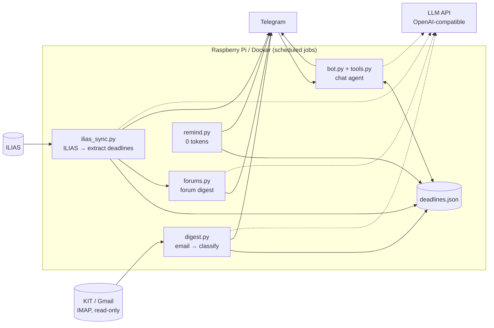

# KIT Study Assistant

[](https://github.com/lattiezhao-a11y/kit-study-assistant/actions/workflows/docker.yml)

**English** · [中文](README.zh-CN.md) · [Deutsch](README.de.md)

A lightweight, self-hosted AI assistant for KIT students. It runs on a Raspberry Pi or any small server (Docker), and talks to you through Telegram.
It reads your university email and ILIAS (KIT's learning platform), finds every deadline, and reminds you before it's too late.
You can also ask it questions in plain language. The bot speaks Chinese or German, your choice.

- **Zero dependencies:** Python standard library only, about 3,000 lines in total
- **Cheap:** if nothing changed, a run costs 0 tokens. One chat message costs about 500–3,000 tokens
- **Read-only by design:** it never sends, deletes, moves or marks email as read

> I built this for my own semester. It has been running every day on a Raspberry Pi 4 since November 2026.

<!-- Screenshots: add 2–3 images to docs/screenshots/ and uncomment.
<p>
  
  
  
</p>
-->

## The problem

Every course on ILIAS publishes deadlines differently:

| Course | Where the deadline lives |
|---|---|
| Course A | In the ILIAS calendar (iCal) |
| Course B | In a folder name: `Übungsblatt 03 (16.11.2026 - 23.11.2026)` |
| Course C | In a table on the course page: "Übung 1–7, jeweils 12 Uhr" |
| Course D | Only inside the exercise sheet PDF |

On top of that, deadlines get postponed by email, and the important emails are buried under newsletters.
Other tools only cover part of this. ILIAS downloaders such as [PFERD](https://github.com/Garmelon/PFERD) fetch files but don't read deadlines.
Deadline bots usually target Canvas or Moodle, which have a proper API.

## What it does

| | Feature | When |
|---|---|---|
| 📬 | **Email digest:** classifies new mail from KIT and Gmail into *must act* / *maybe read* / *ignored*. Each email gets its original subject plus a one-line summary in your language. Ignored emails are still listed, so you can spot mistakes | 01:30, 07:30, 13:30, 19:30 |
| 📚 | **ILIAS deadline sync:** reads the iCal feed, course pages, folder names and new exercise PDFs. An LLM extracts the deadlines | same runs |
| 🔁 | **Postponements:** if an email says a deadline moved, the old date is crossed out and the new one is added | same runs |
| 💬 | **Forum digest:** one sentence per ILIAS forum thread with new posts | daily, 19:30 |
| ☀️ | **Morning summary:** deadlines and to-dos for the next 3 days | 07:00 |
| ⏰ | **Urgent reminder:** anything due within 3 hours | hourly, 07–23 |
| 🤖 | **Chat bot:** "What's still due this week?", "I submitted BS sheet 3", "What did the tutor's email say?", "What's on tomorrow?" | always on |

The bot has 19 tools:

| Group | Tools |
|---|---|
| Deadlines | list, add, edit, delete, mark done |
| To-dos | list, add, delete, mark done |
| Email | list, read (read-only, last 7 days) |
| Settings | show, change (change needs your confirmation) |
| Timetable | list, add, remove, plus a combined daily schedule |
| Forum | recent threads, read a thread |

## Architecture



- **Scheduled jobs are plain scripts, not agents.** Each run makes at most one batched LLM call.
- **The chat bot is a minimal tool-calling loop** (`bot.py`, about 400 lines). It uses Telegram long polling, so no port is opened. It only answers your own chat ID and forgets the conversation after 1 hour idle.
- **One shared data file.** Email, ILIAS and the bot all write to `deadlines.json`, protected by a file lock.

## Design decisions

**Spend tokens only on new information.**
Every ILIAS page is compared with the version seen last time, so only changed text goes to the LLM.
Of the new files, only those whose names look like exercises (`Übung`, `Blatt`, `Exercise`, `Abgabe`…) get their first PDF page read.
Emails are stripped of HTML, quotes, signatures and links, then cut to about 300 characters each.
Some real numbers:

| Task | Tokens |
|---|---|
| Classifying 8 emails | about 1,300 |
| First full ILIAS crawl (found 13 deadlines) | about 15,000 |
| ILIAS run when nothing changed | 0 |
| One chat message | 500–3,000 |

For comparison, the same chat through a general-purpose agent framework (OpenClaw) took roughly 10,000–20,000 tokens per message. That's why I wrote my own small bot.

**Never lose an important email.**
When the LLM is unsure, it picks *maybe read* instead of *ignored*.
Every ignored email is still listed by sender and subject.
A safety net (a list of senders) can only move emails *up* in importance, never down.
If a mailbox or the LLM fails, the digest still goes out and says what broke. Unclassified emails get their own section.

**Safety.**
- Mailboxes are opened read-only and fetched with `BODY.PEEK`, so mail is never marked as read. There is no SMTP code at all.
- The LLM can only *propose* a settings change. The program applies it after you reply «确认» or «ja» ("confirm"), and backs up the config first.
- Forum posts are sent to the LLM without names, only as "teacher/tutor" or "student".
- Prompts tell the model to ignore instructions found inside emails. An invalid category from the model counts as *unclassified*.
- All secrets live in `.env` (`chmod 600`). Nothing secret is in the code or the config.

## Setup

All you need is a computer that is always on. It doesn't have to be a Raspberry Pi: a free or cheap cloud server, a NAS or an old laptop works too.
You also need a Telegram bot token from [@BotFather](https://t.me/BotFather) and an API key for any OpenAI-compatible LLM (I use DeepSeek).

### Option 1: Docker (recommended, works anywhere)

```bash
git clone https://github.com/lattiezhao-a11y/kit-study-assistant.git
cd kit-study-assistant
mkdir data
docker compose run --rm assistant python3 setup.py              # setup wizard, about 5 minutes
docker compose run --rm assistant python3 digest.py --dry-run   # test, sends nothing
docker compose up -d                                            # start
```

📖 **Step-by-step guide, from an empty cloud server to the first Telegram message: [docs/deploy-cloud.md](docs/deploy-cloud.md)** ([中文](docs/deploy-cloud.zh-CN.md) · [Deutsch](docs/deploy-cloud.de.md))

Inside the container, a small scheduler (`scheduler.py`) replaces systemd. It runs the same timetable, keeps the bot alive, and catches up a missed email check after a restart.
Your settings and data live in `data/`, separate from the code.

### Option 2: directly on a Raspberry Pi / Linux with systemd

This is how I run it. You need Python 3.11+ and `poppler-utils` (to read PDFs).

```bash
sudo apt install poppler-utils
git clone https://github.com/lattiezhao-a11y/kit-study-assistant.git
cd kit-study-assistant/mail_digest

python3 setup.py                             # setup wizard: writes config.toml and .env

python3 digest.py --dry-run --no-llm         # read mail, print only, no AI, no Telegram
python3 digest.py --dry-run                  # with AI, still print only
python3 ilias_sync.py --dry-run              # ILIAS deadlines, print only
```

To run it automatically, install the systemd units:

```bash
sudo cp deploy/*.service deploy/*.timer /etc/systemd/system/
sudo systemctl daemon-reload
sudo systemctl enable --now mail-digest.timer morning-summary.timer remind.timer bot.service
```

The unit files assume the user `pi` and the path `/home/pi/mail_digest`. Edit them if yours differ.

**Gmail** needs 2-step verification and an [app password](https://myaccount.google.com/apppasswords).
**Hotmail/Outlook.com** no longer allows passwords over IMAP. Forward it to Gmail instead.

### The setup wizard

`setup.py` first asks for your language (Chinese or German), then asks one question at a time and checks each answer right away:

- **KIT account:** logs in to ILIAS and the KIT mailbox (read-only), so a typo shows up immediately
- **Courses:** **lists every course you joined on ILIAS**, grouped by semester, with this semester's courses pre-selected. Your Tutorium groups are matched to their courses automatically, so you never have to copy course IDs from URLs
- **LLM key:** checked through the `/models` endpoint, which costs 0 tokens
- **Telegram:** you send your bot one message, and the wizard finds your chat ID by itself

Passwords are typed invisibly and only written to `.env` (`chmod 600`). Nothing is saved until the last question is answered, and Ctrl+C changes nothing.
To fill in the files by hand instead, copy `config.example.toml` and `.env.example`.

**New semester?** `python3 setup.py --courses` picks the courses again and leaves every other setting alone.
To just look at your courses: `python3 ilias_courses.py`.

## Tests

```bash
python3 tests/run_tests.py            # 100+ checks, about $0.05 of tokens
python3 tests/run_tests.py --no-llm   # tool tests only, 0 tokens
python3 tests/test_setup.py           # setup wizard + course list, offline, 0 tokens
```

The tests work on temporary copies of the data, so your real deadlines and settings are never changed and nothing is sent to Telegram.
Part A calls every tool directly. Part B sends about 20 natural-language requests to the model and checks that it picks the right tool, asks for confirmation before changes, and never shows internal IDs.

## Limitations

- **The ILIAS login works only for KIT** (Shibboleth via `idp.scc.kit.edu`, no 2FA), so the ILIAS part won't work at other universities yet. The email part works with any IMAP mailbox.
- **The bot, its messages and the setup wizard are in Chinese or German** (pick one in the wizard, or switch anytime with /language in Telegram). There is no English interface yet; all texts live in `i18n.py`, so adding a language is mostly translation.
- **Most tests need a real `config.toml`** and mailbox access. GitHub Actions only builds the Docker image and runs the tests that need no account (formatting, data folder, scheduler, setup wizard).
- **Opening forum threads marks them as read in ILIAS.** That is how ILIAS works. Nothing else is changed there.
- Without Docker it runs on Linux/macOS only (uses `fcntl`). On Windows, use Docker.

## Roadmap

- [x] Docker image + cloud deployment guide, so no Raspberry Pi is needed
- [ ] Configurable ILIAS instance and login, so other universities can use it
- [x] Interactive setup wizard (`setup.py`) that lists your ILIAS courses and finds your Telegram chat ID
- [x] German version (bot, messages, setup wizard)
- [x] GitHub Actions: build the Docker image + tests that need no account
- [ ] Offline test fixtures (fake mailbox / ILIAS pages), so every tool can be tested on GitHub
- [ ] Evaluation set for deadline extraction (precision / recall)
- [ ] Optional local LLM (Ollama), so no data leaves the device

## License

[MIT](LICENSE)
